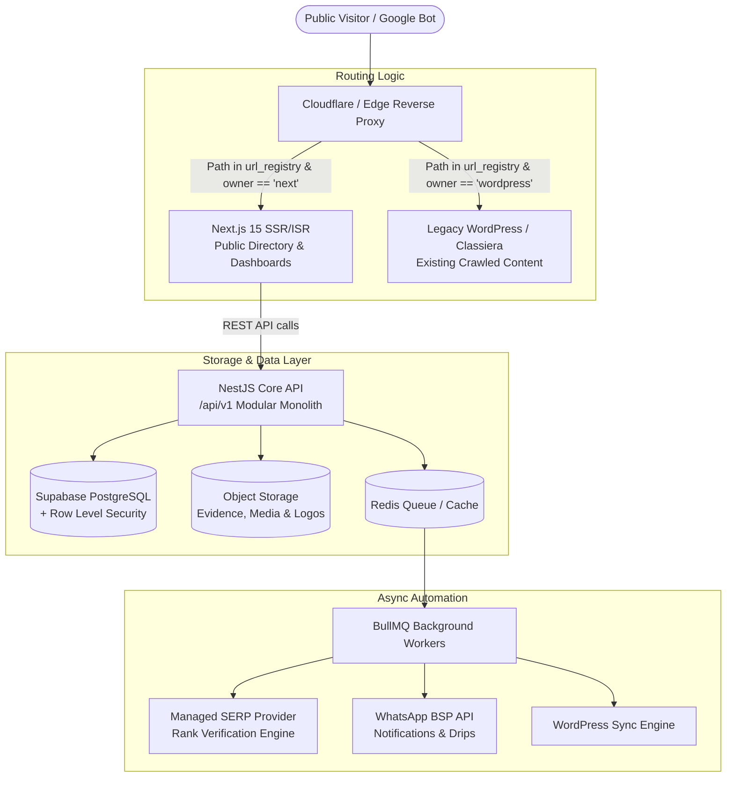

# BharatBN™ — Master Implementation & Architecture Blueprint
**Product:** BharatBN — AI-Powered Business Discovery & Enterprise Visibility Platform  
**Owner:** Bizwoke Nova | Mission FTC™ | Engine 7  
**Architecture:** Hybrid WordPress/Classiera + Next.js 15 (App Router) + NestJS + Supabase PostgreSQL  
**Timeline:** 12 Weeks (6 Sprints: S0 to S5) | 5-Developer Workstream  

---

## 1. System Architecture Overview



---

## 2. Monorepo Structure (Turborepo + pnpm)

```text
bharatbn/
├── apps/
│   ├── web/                     # Next.js 15 (App Router, Tailwind CSS, shadcn/ui)
│   │   ├── app/
│   │   │   ├── (public)/        # SSR/ISR: Home, Search, Category, City, Profile, Compare
│   │   │   ├── (auth)/          # Login, Register, OTP verification
│   │   │   ├── (portal)/        # Dashboard: Owner, Franchise HQ, Branch Manager, SEO
│   │   │   └── (admin)/         # Superadmin & Moderation Console
│   │   └── middleware.ts        # Dynamic route lookup & Edge URL rewrite rules
│   │
│   └── api/                     # NestJS 10+ REST API (/api/v1)
│       └── src/modules/
│           ├── auth/            # Supabase Auth sync + JWT RBAC Guards
│           ├── businesses/      # Directory listing CRUD, slug generator, NAP
│           ├── claims/          # Business claim & verification workflows
│           ├── taxonomy/        # Categories & Geo hierarchy (State/District/City/Locality)
│           ├── franchise/       # Brand HQ, Bulk branch CSV import & manager RBAC
│           ├── leads/           # Consent-logged inquiry capture & WhatsApp triggers
│           ├── subscriptions/   # Tier plans, sponsor slots, payment webhooks
│           ├── pay-as-you-rank/ # Campaigns, SERP scraper worker, milestone approvals
│           ├── seo-engine/      # SSR JSON-LD generator, dynamic sitemaps, AI drafts
│           └── url-registry/    # Hybrid routing registry & WP proxy resolver
│
├── packages/
│   ├── database/                # Supabase migrations, Prisma/Drizzle schema, seeds
│   ├── shared-types/            # Shared DTOs, Enums, API interfaces
│   └── config/                  # ESLint, Prettier, TypeScript base configs
│
├── docker-compose.yml           # Local Redis, Postgres, Mailhog, MinIO (local S3)
└── turbo.json
```

---

## 3. Core Database Schema & Entities

### Key Tables
1. **`url_registry`**:
   - `id`, `path` (UNIQUE, indexed), `owner` (`wordpress` | `next`), `status_code` (`200`, `301`, `410`), `redirect_target`, `entity_type`, `entity_id`.
   - *SEO Safety*: Enforces single canonical origin per URL. Zero broken legacy links.
2. **`businesses`**:
   - `id` (UUID), `name`, `slug` (UNIQUE), `nap_hash`, `phone`, `whatsapp`, `email`, `website`, `address_json`, `lat_lng` (`GEOGRAPHY(Point)`), `status` (`draft` | `pending_review` | `published` | `archived`), `owner_org_id`, `verified_at`.
3. **`brands` & `branches`**:
   - Multi-tenant enterprise franchise model. HQ can manage all outlets; Branch Managers can access only their assigned branch.
4. **`claims`**:
   - `id`, `business_id`, `claimant_id`, `evidence_doc_url`, `review_status` (`pending`, `approved`, `rejected`), `reviewed_by`.
5. **`seo_campaigns`, `rank_checks` & `milestones`**:
   - Exact keyword, city, device, and baseline rank.
   - Milestone triggers:
     - 25% Advance payment on activation.
     - 25% Top-20 ranking verified.
     - 50% Top-10 ranking verified.
   - Dual-verification: Requires 2 matching observations $\ge 24\text{ hours}$ apart plus SEO Manager manual approval.

---

## 4. 12-Week Sprint Execution Roadmap

| Sprint | Timeline | Deliverables |
| :--- | :--- | :--- |
| **S0** | Weeks 1–2 | Monorepo setup, Supabase ERD & migrations, WP/Classiera data crawl, Edge reverse proxy bridge. |
| **S1** | Weeks 3–4 | Auth & RBAC (10 roles), Business Directory CRUD, Public SSR/ISR pages with JSON-LD schema. |
| **S2** | Weeks 5–6 | Geo & Category search filters, Claim & Verification workflow, WP $\to$ Supabase sync worker. |
| **S3** | Weeks 7–8 | Franchise Brand/Branch bulk onboarding, Branch manager roles, Leads capture with DPDP consent. |
| **S4** | Weeks 9–10 | Subscriptions, Pay-As-You-Rank™ engine, SERP provider rank checks, Milestone billing & payment webhooks. |
| **S5** | Weeks 11–12 | WhatsApp transactional messaging, AI content drafting with approval gates, QA tests (QA-01 to QA-14), Pilot release. |

---

## 5. Five-Developer Team Responsibilities

- **D1 (Tech Lead / NestJS)**: Core API architecture, security, RBAC guards, payment webhooks, database integrity.
- **D2 (Next.js Specialist)**: Public directory, SSR/ISR templates, JSON-LD schemas, Core Web Vitals (LCP $\le 2.5\text{s}$), responsive UI.
- **D3 (Database / Migration)**: Supabase schema, RLS policies, WordPress data extraction, URL registry, sync pipelines.
- **D4 (Enterprise & Dashboards)**: Franchise HQ dashboard, Branch manager portals, Claim approval queue, Leads analytics.
- **D5 (Automation & QA)**: BullMQ background jobs, SERP API integration, WhatsApp notifications, E2E & SEO tests.

